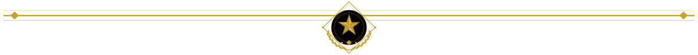
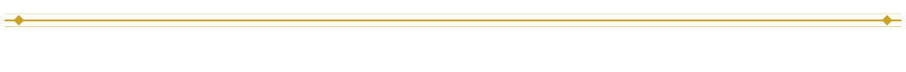
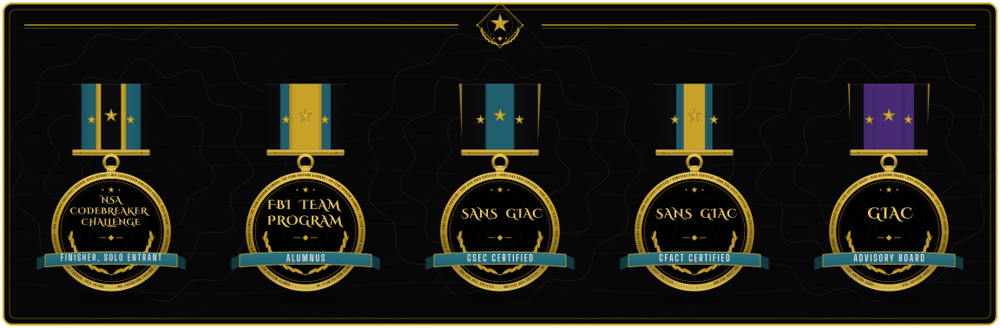
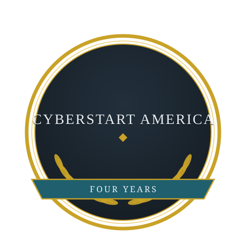
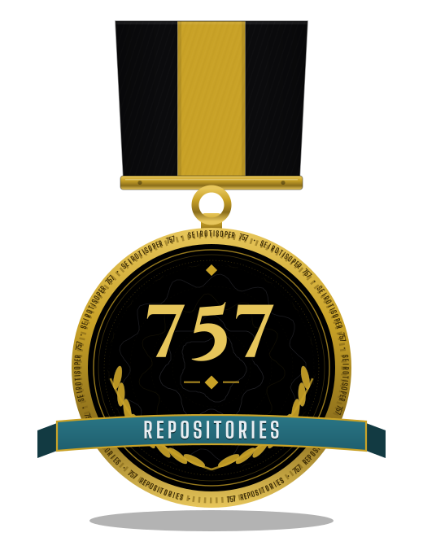

# ShadowStrikeOS

ShadowStrikeOS is the home of ShadowStrike OS, my custom security-focused Linux distribution for penetration testing and security research.

By Gavin Blacklock (Gavin K.) ([@Epsilon0xCell](https://github.com/Epsilon0xCell)).

## The Evidence

| Measure | Count |
|---|---|
| Platform projects housed here | 1 |
| Repositories in the fleet | 757 |
| Audited line by line | 754 |
| Live secrets found | 0 |

The platform, in short: one distribution, built for security research and documented like everything else in the fleet.

## The Elite Row

Every claim here can be checked against the public record.

## The Record

  

